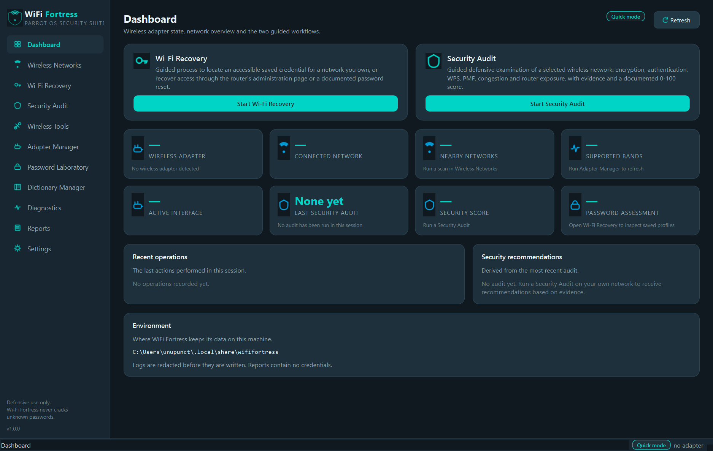
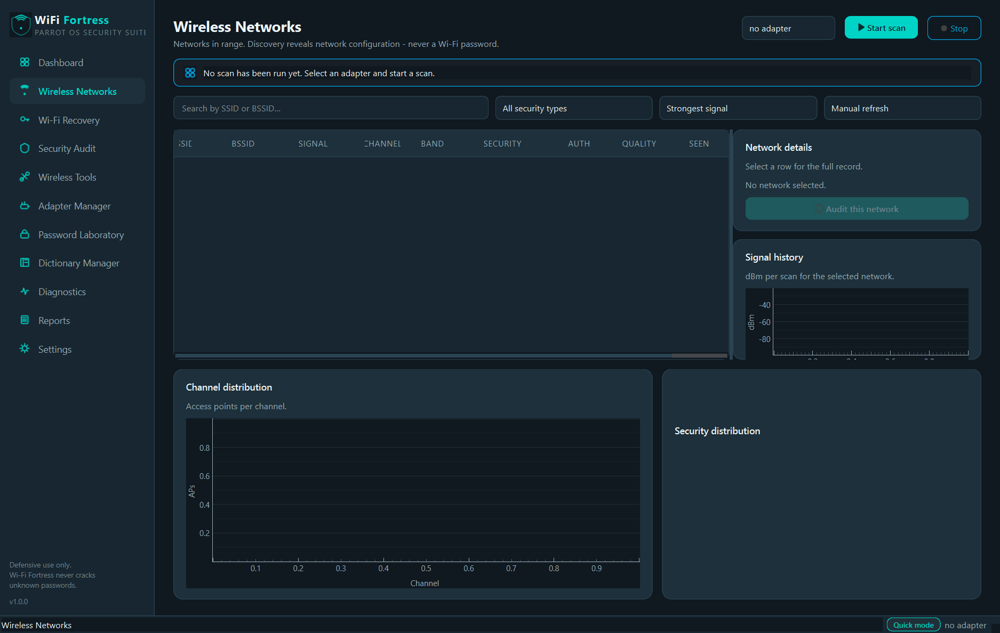
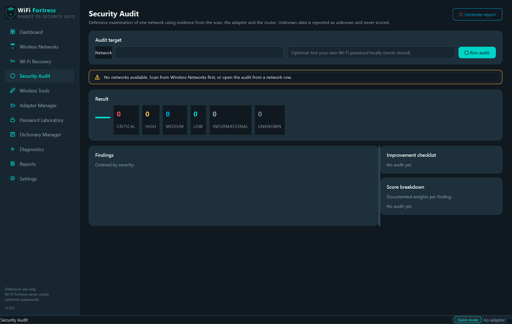
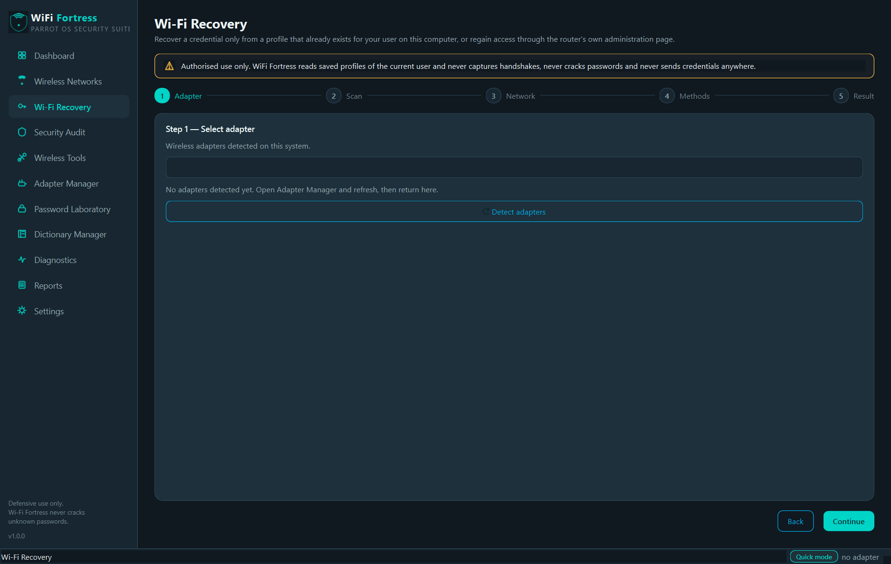
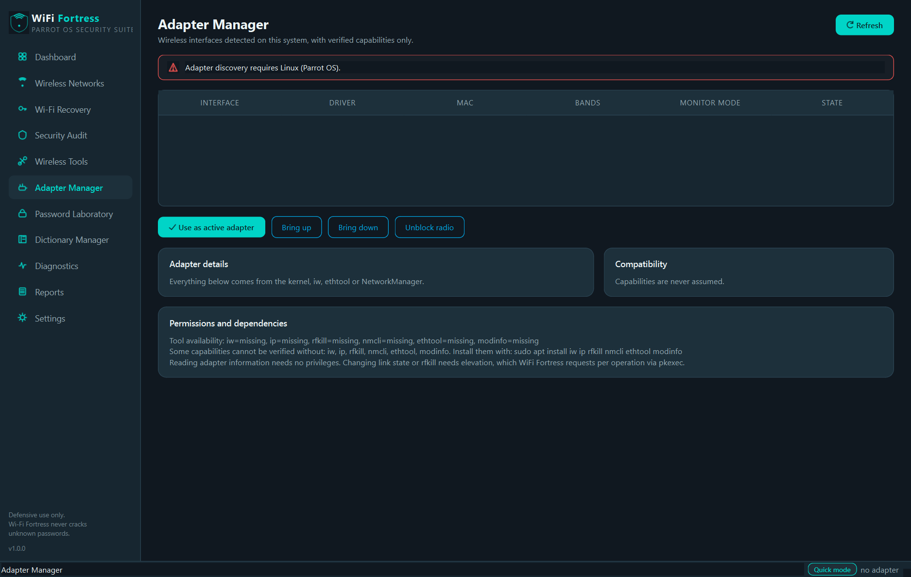
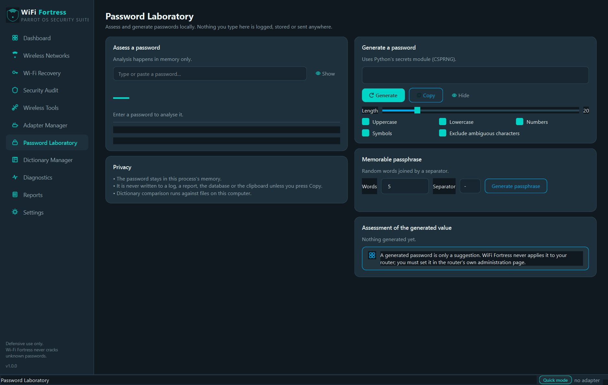
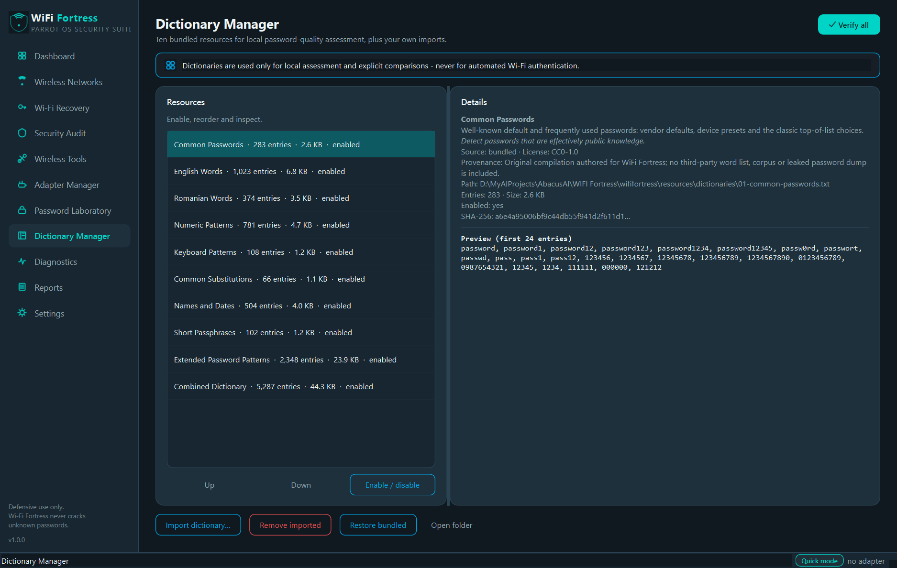
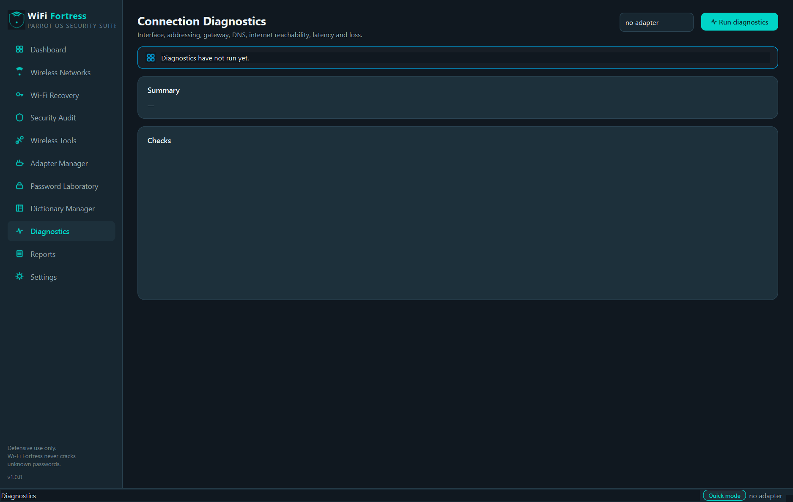
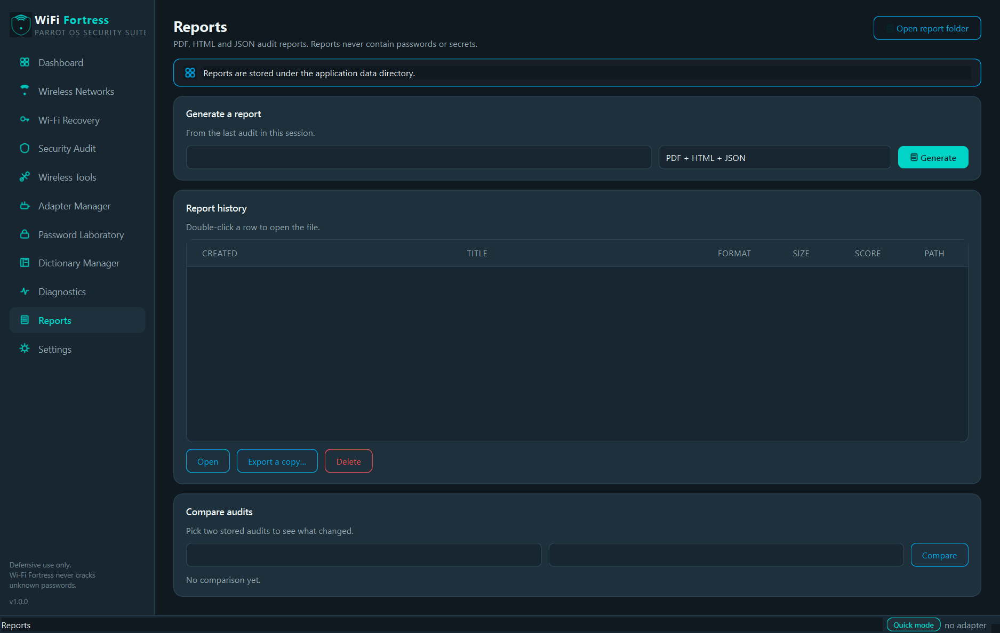

# WiFi Fortress

**A desktop wireless-security suite for Parrot OS.** Adapter management, Wi-Fi
discovery, authorised credential recovery, defensive security auditing,
password assessment, dictionary management, connection diagnostics and
PDF/HTML/JSON reporting — in one application instead of a dozen terminal tools.



---

## What it does

| Section | What it actually does |
|---|---|
| **Dashboard** | Adapter state, nearby network summary, last audit, recent operations |
| **Wireless Networks** | Scans with `iw` (falls back to `nmcli`), classifies WPA2/WPA3/WEP/Open/Enterprise strictly from the RSN/WPA information elements, shows channel congestion and signal history |
| **Wi-Fi Recovery** | Guided 5-step process to read a credential **your user account already has saved** (NetworkManager profiles and keyfiles), or documented router-reset and router-admin routes |
| **Security Audit** | Documented 0–100 score with per-finding evidence, explanation, impact and recommendation; before/after comparison |
| **Wireless Tools** | Detects installed Parrot wireless tools and their versions — it does not run cracking, handshake-capture or deauthentication workflows |
| **Adapter Manager** | Interface state, driver, chipset, PHY capabilities, bands, monitor-mode support, rfkill and link control |
| **Passphrase Hardening** | Models how long an offline attack on a captured handshake would need for the passphrase you actually set — per-hardware estimates, weakest-link analysis, WPA3 comparison and a concrete fix list. Pure arithmetic: nothing is attacked |
| **Password Laboratory** | Local-only password strength assessment and CSPRNG generation, including passphrases from the bundled word lists |
| **Dictionary Manager** | Ten bundled word lists with verified provenance, plus import/verify/enable/reorder of your own |
| **Diagnostics** | Interface, addressing, gateway, DNS, reachability, latency and packet loss, each with a suggested fix |
| **Reports** | PDF, HTML and JSON reports; reports never contain passwords or secrets |
| **Settings** | Quick/Advanced mode, data locations, environment detail |

## Screenshots

| | |
|---|---|
|  |  |
|  |  |
|  |  |
|  |  |

---

## Install on Parrot OS

> Full step-by-step guide with a first-run checklist and troubleshooting table:
> **[docs/INSTALL.md](docs/INSTALL.md)**

### Option A — the `.deb` package (recommended)

```bash
# 1. Install the runtime dependencies
sudo apt update
sudo apt install python3-pyside6.qtwidgets python3-reportlab \
                 iw network-manager rfkill ethtool pciutils usbutils
sudo apt install python3-pyqtgraph        # optional: charts on the dashboard

# 2. Install WiFi Fortress
sudo dpkg -i wifi-fortress_1.0.0_all.deb

# 3. Fix any missing dependency, if dpkg complains
sudo apt --fix-broken install

# 4. Start it — from the application menu ("WiFi Fortress"),
#    or from a terminal:
wifi-fortress
```

### Option B — from a source checkout

```bash
git clone https://github.com/unupunct/WiFi-Fortress.git
cd WiFi-Fortress
sudo ./packaging/debian/install.sh
```

The installer copies the application to `/opt/wifi-fortress`, adds
`/usr/bin/wifi-fortress`, a menu entry and an icon, then runs a headless
self-test.

### Option C — run without installing

```bash
git clone https://github.com/unupunct/WiFi-Fortress.git
cd WiFi-Fortress
python3 -m venv .venv && . .venv/bin/activate
pip install -r requirements.txt
python3 run.py
```

> **Do not run the GUI as root.** It asks for elevation per operation
> (`pkexec`/`sudo`). Starting it with `sudo` shows a warning and exits.

### Verify the installation

```bash
wifi-fortress --selftest
```

Prints the data directory, the number of readable dictionary entries, a
password-assessment score, generated-password length, detected adapters and
available tools. Exit code `0` means the non-GUI layers are healthy.

---

## Uninstall

```bash
sudo apt remove wifi-fortress          # .deb install
sudo ./packaging/debian/uninstall.sh   # source install
```

Your data is kept. To delete it as well:

```bash
sudo apt purge wifi-fortress
sudo ./packaging/debian/uninstall.sh --purge
```

---

## Build the package yourself

```bash
sudo apt install dpkg-dev fakeroot
./packaging/debian/build_deb.sh
# -> packaging/debian/wifi-fortress_1.0.0_all.deb
```

---

## Public word lists — 49 verified sources, downloaded on demand

The Dictionary Manager carries a catalogue of **49 public word lists**, each
checked to exist when it was added: the raw URL answers and the file is plain
text. Filter by category or by *Wi-Fi focused only*, read the licence and
description, then **Download**, **Download + import**, or open the project page
in your browser.

Downloadable in one click (24 single files):

- **Wi-Fi specific** — SecLists *probable WPA top 4800*, Probable-Wordlists
  *WPA 204k / 4800 / 447*, kkrypt0nn *probable_wpa*, the wifite and fern-wifi
  lists from `00xZEROx00/kali-wordlists`
- **Common passwords** — SecLists *10k / 1M / 500 worst / NCSC 100k / 2025 top
  200*, the devoxel gist (10,000 entries), kkrypt0nn *most used*, All-Wordlists
  *john / weaksauce*, duyet *1M*, FuzzDB
- **Router defaults** — SecLists default-credentials lists

The other 25 are reference links to project pages and archives (rockyou,
weakpass, CrackStation, haveibeenpwned, Hob0Rules, full repositories): openable
in one click, but not streamed here.

Every download is size-capped, streamed to disk, unpacked if gzipped, rejected
if it is binary, and recorded with its source URL, upstream licence and SHA-256.
Nothing is fetched until you ask for it, and no list is ever bundled.

## Passphrase Hardening — the defensive answer to "is my password crackable?"

You do not need to capture and crack your own handshake to find out. The
**Passphrase Hardening** page takes the passphrase you set on your router and
models the offline attack an adversary would have to run after capturing a
handshake:

- Time to recover it on a CPU core, an entry-level GPU, a mid-range GPU, a
  flagship GPU and an 8-GPU rig, using published PBKDF2 rate figures.
- The **weakest link** — dictionary word, keyboard walk, repeated characters,
  short length, or none found.
- The same passphrase against **WPA3-SAE**, where each guess must be replayed
  live, per connection.
- A concrete list of changes, and the resulting verdict feeds the Security
  Audit so the network score reflects real attack resistance.

Nothing is transmitted, logged or stored, and no cracking is performed. The
model is arithmetic over the same local dictionary matching used by the
Password Laboratory.

## What it will not do

WiFi Fortress is a **defensive** tool. It deliberately contains no
handshake capture, no deauthentication, no WPS brute force and no password
cracking. `aircrack-ng`, `hcxdumptool`, `kismet` and similar are detected for
inventory purposes only.

It also will not present a guess as a recovered password. A credential is
shown only when it was read from a profile that already exists on the machine.
Everything it cannot determine is reported as *Unknown — not determinable* and
is never scored.

## Safety properties

- Passwords are never written to logs, the database, reports or the clipboard
  history; every log line and every report field passes through a redactor.
- Commands run with argument lists, never through a shell; interface names,
  MAC addresses and host targets are validated first.
- The GUI never runs as root; each privileged operation is elevated separately.
- Reports and the database live in your XDG directories, never in the
  installation directory.

---

## Development

```bash
python -m pytest -q            # 154 tests
python scripts/screenshot.py   # regenerate docs/screenshots
python scripts/build_dictionaries.py   # rebuild the word lists
```

Layout:

```
wififortress/
  app/        entry point, application context
  core/       paths, logging, redaction, process runner, privileges, database
  models/     entities and enums
  services/   adapter, discovery, recovery, audit, tools, diagnostics,
              password, dictionary, report, router assistant, settings
  ui/         theme, workers, one module per sidebar section
  widgets/    cards, pills, charts, painter-drawn icons
  resources/dictionaries/   10 bundled CC0 word lists + manifest
tests/        pytest suite and fixtures
packaging/    Debian package, launcher, desktop entry, icon, install/uninstall
```

## Dictionary provenance

All ten bundled lists were authored for this project and are released
**CC0-1.0**. No third-party word list, corpus or leaked password dump is
included. Each file is checksummed in
`wififortress/resources/dictionaries/manifest.py` and verified from the
Dictionary Manager.

## Licence

GPL-3.0-or-later for the application; CC0-1.0 for the bundled dictionaries.
See `packaging/debian/copyright`.

## Scope

Tested on Parrot OS (Debian bookworm base) with Python 3.12+ and PySide6 6.6+.
The application starts on Windows for development, but adapter discovery,
scanning, recovery and diagnostics require Linux and say so explicitly instead
of showing invented data.
